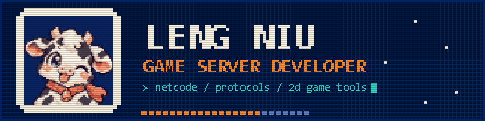

I work on the server side of online games: network protocols, game logic, in-game economies and the tools that keep a live server running. I also build tools for 2D game assets: maps, sprites and fonts.

### ▌Focus

- Server architecture: connections, channels and map instances, scheduling and persistence
- Network protocols: parsing, design and staying compatible with old clients
- Game systems: quests, dungeons, trading, mini games and events
- Live ops tools: GM consoles, bots, monitoring and auto updates
- Databases: MySQL and SQL Server schema design, backups and tuning

### ▌Networking

| Project | |
| --- | --- |
| [sidescroll-net](https://github.com/vtxe02023274/sidescroll-net) [play](https://vtxe02023274.github.io/sidescroll-net/) | Authoritative server for 2D side-scrolling multiplayer: client prediction with zero corrections, interpolation, lag compensation, delta snapshots and view culling. |
| [pktspec](https://github.com/vtxe02023274/pktspec) | Describe game packets once in YAML, generate Java encoders and decoders plus docs. |

### ▌2D game tools

| Project | |
| --- | --- |
| [isotiles](https://github.com/vtxe02023274/isotiles) [try it](https://vtxe02023274.github.io/isotiles/) | Isometric and staggered map editor in the browser. Reads and writes Tiled maps and renders them pixel for pixel like Tiled. |
| [aseview](https://github.com/vtxe02023274/aseview) [try it](https://vtxe02023274.github.io/aseview/) | View Aseprite files and export sprite sheets, GIFs per tag, scaled and per layer, in the browser or from the command line. |
| [fntview](https://github.com/vtxe02023274/fntview) [try it](https://vtxe02023274.github.io/fntview/) | Check, convert and make BMFont bitmap fonts, including SDF and MSDF, or build one from a .ttf. |
| [tiledcheck](https://github.com/vtxe02023274/tiledcheck) | Lint Tiled maps for missing files, out of range tiles, overlapping or unused tilesets, locally or in GitHub Actions. |

### ▌Stack

`Java` `C++` `C#` `TypeScript` `MySQL` `SQL Server` `Netty` `Windows Server`
